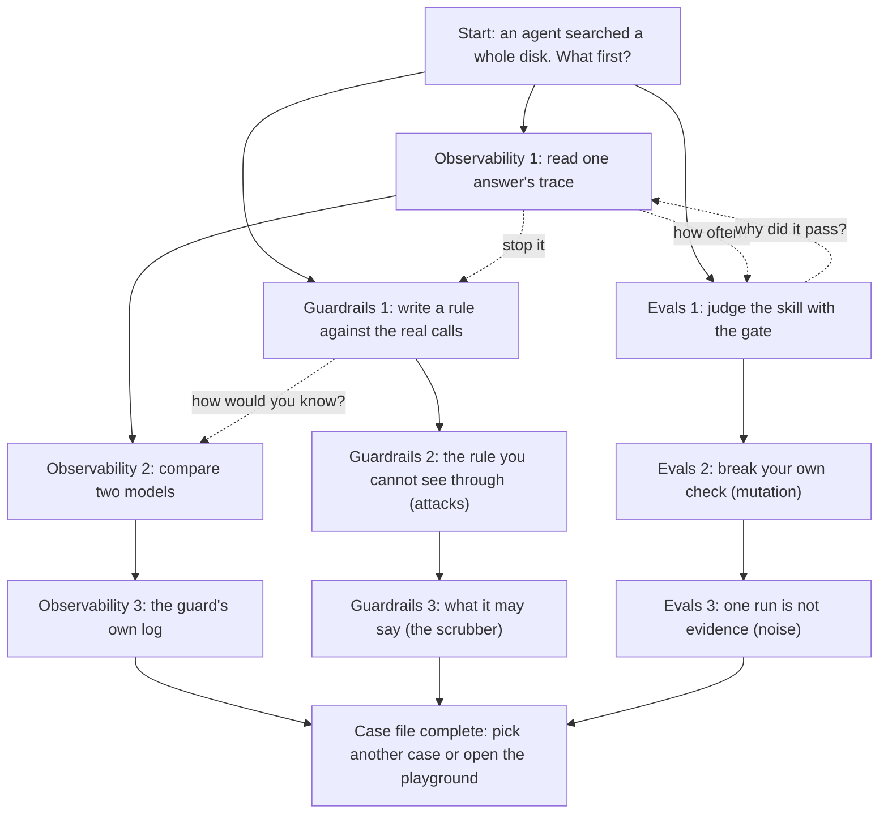

# agent-lab UX/UI review, and a choose-your-own-adventure redesign

Written 2026-11-18 after a headless audit of every screen (1440x860 and 390x844) and four rounds of de-cluttering. Nothing here has been
played by a human yet: that is the first thing to fix, and the redesign below is built so a person can be put in front of it in a day.

## Verdict
The site is **correct and deep but organised like a manual**. It has a lot to teach, a good hook (real recorded data, predict-then-reveal),
and it is now calm screen by screen. What it lacks is a *reason to go in*: no story, no choice, and one pillar (evals) is 7 of 10 lessons while
observability has 1 and guardrails 2. A visitor is handed a syllabus. A good game, or a good explorable explanation, hands you a mystery and a
toy and lets you pick where to poke.

## Evidence (measured, not felt)
| What | Number | Why it matters |
|---|---|---|
| Lessons by pillar | evals 7 (21 steps), guardrails 2 (10), observability 1 (3) | The three-pillar framing on the Start screen is not what the site is |
| Navigation surfaces | left rail (8 modes), the path (5 ideas, 10 lessons), "explore freely" grid, Practice (6 challenges), 3 Guardrails tabs, header chips | Four ways to get to the same places; none says "start here, then choose" |
| Choices on the first screen | 24 buttons, 425 words (was 21 and 593) | Better, still a menu |
| Clicks from load to the first thing that reacts | 2 (Start, then a prediction) | Good. This is the strength to keep |
| Words in a lesson step | 57 to 120 before the answer, 150+ after | Reading, not playing |
| Panel taller than the viewport | Gate 985, A/B skill 1,006, Break after auto-mutate 1,423 | The data screens still scroll (the rest now fit) |
| Jargon in labels | Gate, A/B fact, A/B skill, mutation, heldout, escape, indirection | Each needs a lesson before it means anything |
| Phone | the canvas is replaced by a text summary | The toy disappears exactly where attention is scarcest |
| Human playtests | 1 (the owner, informally) | Their verdict (too busy; wants to be invited to play, with the three pillars as separate adventures) drives this review; the numbers above are still from a script |

## What is wrong, in order of cost
1. **No narrative spine.** Ten lessons in a row, each a topic. Nothing carries over except the vocabulary.
2. **The pillars are labels, not paths.** The headline names guardrails, observability and evals; the site then teaches evals and appends the rest.
3. **One route.** Everyone walks the same 10 steps in the same order, so a second visit is the same visit, and a beginner who stalls on lesson 3 has no way to go sideways to something that clicks.
4. **The canvas is a picture, not a toy.** Most things you change are in the right panel; the canvas only shows the result. Direct manipulation (drag a rule onto a call, drop a fact onto the map) is rare.
5. **Modes are tools without a purpose.** "Gate", "A/B fact" and "A/B skill" are things you would use *after* you have a question. The site never gives you the question.
6. **Level toggle as a patch.** Beginner/experienced changes wording, not what you do. An adventure with depth you can choose (stay on the surface, or dig) does the same job without a switch.
7. **Chrome competes with play.** Header chips, a labelled left rail, a status bar and a caption strip are on at once.

## Principles for the redesign (each one testable)
- **One question per screen.** A screen asks one thing and offers one primary action. Test: at most 3 visible controls above the fold in a beat.
- **The canvas is the toy.** The first interaction on every beat is on the canvas, not in a panel. Test: a person can answer the beat by clicking a square, node or cell.
- **Story first, vocabulary on demand.** Terms appear when the story needs them, with a tooltip, never as a heading.
- **Always a next choice.** Every beat ends with 2 or 3 doors, one of which crosses to another pillar.
- **Real data, a different case each time.** The recorded runs already give several cases. A playthrough picks one.
- **A beat is under a minute.** 60 words before the question, 40 after.
- **Nothing is wasted.** Wrong answers are as informative as right ones (already true, keep it).

## The design: one case, three lenses
**The case: "The agent that went looking for the answer."** This is real. Recorded in this repo: asked a question about a skill, a small model with no skill
made about 7 tool calls per answer and ran `find /` across the whole disk; with the skill it made about 1. Of 760 real calls, 459 tried to leave the
working folder. Three different questions explain it, and they are the three pillars:

- **Observability: "What happened?"** Read the trace. Which calls, in what order, what did they cost, did it open the skill.
- **Guardrails: "Should it have been allowed to?"** Write the rule. See what it stops, what it blocks by mistake, and the one thing it misses.
- **Evals: "Did the skill actually help?"** Judge it. The gate says ADOPT. Is that trustworthy? Break your own check.

**Start screen** (one decision, nothing else):
> An agent just searched an entire disk to answer one question. What do you want to know first?
> [ What happened? ]  [ Should it have been allowed? ]  [ Did it actually work? ]
> (small: or just play with the tools)

Each choice opens a **chapter of 3 beats** on the same case. At the end of every beat you get doors, for example after the trace beat:
- *See how often it happens* (evals, beat 1)
- *Stop it* (guardrails, beat 1)
- *Go one level deeper into this trace* (same pillar, beat 2)
- *Try it yourself* (playground, pre-loaded with this case)

**A "case file"** (a small progress board, not a syllabus): three columns, three beats each, filled as you go. It shows which doors you took, so the next
playthrough can be different on purpose ("you have not looked at this from guardrails yet").

**Variety on a second visit.** Three cases ship with data we already have: *dst on haiku* (the searching agent), *evidence-gated on sonnet* (the skill that
helps but costs twice as much) and *doubt on haiku* (a model that reads the skill and still fails). Each case is a different story through the same three lenses.

## What exists and where it goes (reuse, not rewrite)
| Today | Becomes |
|---|---|
| Lessons eval, rank, break, gate, skill, recorded, noise (7) | Evals chapter beats and the deep branch; `rank` moves to the playground as "how search ranks" |
| Lesson trace + Gate trace fold + code-panel line tracing | Observability beats 1 and 2; the trace fold becomes a timeline you click |
| Guardrails mode "What it may do", lesson guard (6 steps) | Guardrails beats 1 and 2 |
| Scrubber tab and lesson | Guardrails beat 3 |
| Guardrails "Your log" tab | Observability beat 3 (the guard's own decision log) |
| Modes (Map, Evals, Break, Gate, A/B fact, A/B skill, Guardrails) | The **playground**, entered from any beat with the case pre-loaded; the left rail shrinks to Case file / Playground |
| Challenges (6) | End-of-chapter "prove it" tasks |
| Beginner/experienced toggle | "Go deeper" doors: the same beat with the code panel and the editor |

## What has to be built
1. **Beat engine** (small): a lesson step gains `doors: [{label, to}]` and a `case`; the lesson card renders doors instead of Next. Existing steps keep working as one-door beats.
2. **Start screen and case file** (small to medium): three cards, a 3x3 board, state in localStorage.
3. **Trace timeline** (medium, new): one answer's tool calls as a row of blocks on the canvas (colour = inside, outside, blocked; width = cost). Click a block to read it. This is the missing observability toy and it reuses the recorded rows.
4. **Canvas-first beats** (medium): for each beat, name the one canvas action that answers it (click the red squares, drag the threshold, click the leaking text) and move the controls it needs onto the canvas.
5. **Case data** (small): three cases as data (`run`, `skill`, `story`, `open question`) over the recordings that exist.
6. **Phone**: keep the toy. A scrolling strip of squares you tap, not a text summary.
7. **Playtest harness**: a build flag that logs where a person stalls (which beat, how long, which door), kept local, so the first five humans give numbers.

## Order of work, each ending in something testable
1. ~~Playtest what exists.~~ **Done by the owner on 2026-11-18**: the site is too busy and should invite you in to play and figure it out, not overwhelm. That feedback is what this document answers. A second round with other people is still worth doing after step 2, to check the new Start screen.
2. ~~Start screen with three doors and the case file, wired to the existing lessons regrouped by pillar.~~ **Done 2026-11-18, no new content.** Start screen at 1440x860: 379 to 138 words, 1252 to 788 px tall (fits the viewport), 18 to 16 visible controls (11 to 16 above the fold, because the content is no longer below it); clicks from load to the first prediction in Observability and Guardrails 2 to 1. Not fixed here: the first Observability step is still 852 words and 4,534 px tall (step 3). Needs a second round of human playtesting.
3. Trace timeline and Observability beats 1 to 3.
4. Re-cut the Evals and Guardrails lessons into 3 beats each with doors, on the dst case.
5. Second and third cases.
6. Phone toy.

## Success criteria
- A first-time visitor makes a choice in under 10 seconds and sees something react in under 30.
- Two playthroughs by the same person take different routes and finish in under 10 minutes each.
- No beat has more than 3 visible controls or 60 words before its question.
- In a five-person playtest, at least four can explain, unprompted, what each pillar is for.

## Risks and open questions
- **Tests.** The UI suites assume the linear path; they need a beat-level rewrite. Budget for it.
- **Cases are only as good as the data.** The searching-agent case is strong; the other two need a check that they tell a clear story.
- **Two upstream moving parts.** The map PR (a lone `/` is the root) changes the Guardrails beats' numbers when it merges, and the `doubt`/`evidence-gated` re-record changes the other two cases' numbers. Land both before cutting beats.
- **Honesty.** The story must not claim more than the data: these are 3 tries on two models, and part of the "searching" is the sandbox denying reads. Each beat keeps its "what this is" line.
- **Scope.** This is a restructure, not polish. Step 2 is a small, reversible first move that tests the idea.
